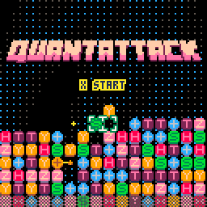

# QuantAttack



量子回路をテーマにした PICO-8 用のアクションパズルゲームです。同じ種類のブロックを縦に 2 つ並べると消えます。一部のブロックは量子コンピュータの命令 (量子論理ゲート) で、実際の量子回路と同じ規則でしか消せません。40 以上の隠れたパターンを見つけることが上達への近道です。

ブラウザで遊べます: https://qniapp.github.io/quantattack/

**English:** QuantAttack is a match-2 action puzzle game for [PICO-8](https://www.lexaloffle.com/pico-8.php). Line up two blocks of the same type vertically to clear them. Some blocks are quantum logic gates that only clear by the rules of real quantum circuits. Play it in your browser at the link above. To build it, install the tools below and run `rake`; `rake test` runs the unit tests and `rake run` starts the game.

## ゲームモード

PICO-8 のトークン数制限のため、ゲームはモードごとに 7 つのカートに分かれています。title カートのメニューから `load()` で各カートを読み込みます。

| カート | 内容 |
| --- | --- |
| `title` | タイトル画面とメニュー (デモ付き) |
| `tutorial` | 遊び方を学ぶ |
| `endless` | できるだけ長く遊ぶ |
| `rush` | 2 分間のスコアアタック |
| `vs_qpu` | QPU (CPU プレーヤー) と対戦 |
| `qpu_vs_qpu` | QPU 同士の対戦を観る |
| `vs_human` | 2 人対戦 |

## ディレクトリ構成

| パス | 内容 |
| --- | --- |
| `src/main_<cart>.lua` | 各カートのエントリポイント |
| `src/lib/` | 全カート共通のコード (盤面、ブロック、QPU、エフェクトなど) |
| `src/<cart>/` | そのカート専用のコード |
| `test/` | busted によるユニットテスト |
| `data.p8` | スプライトと音の編集用カート。ビルド時に `data/builtin_data_<cart>.p8` にコピーされる |
| `data/` | カートごとのデータ、ラベル画像 (`metadata.p8`)、バージョン番号 |
| `scripts/` | ビルド、インストール、リリース、テスト用のスクリプト |
| `pico-boots/` | ビルドとテストに使う [pico-boots](https://github.com/hsandt/pico-boots) (git submodule) |
| `assets/` | スプライトや画像の Aseprite ソース |
| `index.html` ほか | GitHub Pages で公開している Web 版 (`quantattack_v*_release.js` と画像、アイコン) |

ルートにある `index.html`、`quantattack_v*_release.js`、`*.png`、`*.gif`、アイコン類と `manifest.webmanifest` は公開サイトそのものです。GitHub Pages は `main` ブランチのルートを配信しているので、移動や削除をするとサイトが壊れます。

## 必要なもの

- [PICO-8](https://www.lexaloffle.com/pico-8.php) 0.2.5c 以降
- Ruby と Rake (`.tool-versions` に Ruby のバージョンを記載。mise や asdf で入る)
- Lua 5.4、[busted](https://lunarmodules.github.io/busted/)、luacov、bit32 (テスト用)
- [luacheck](https://github.com/lunarmodules/luacheck) (lint 用、任意)
- ビルド用: pico-boots が使う [picotool](https://github.com/dansanderson/picotool) (`p8tool`)、npm でインストールする luamin、Python 3

```sh
git submodule update --init
luarocks --lua-version 5.4 install busted
luarocks --lua-version 5.4 install luacov
luarocks --lua-version 5.4 install bit32
luarocks --lua-version 5.4 install luacheck
```

ツールの場所は環境変数で変えられます。

| 変数 | 既定値 |
| --- | --- |
| `PICO8` | macOS: `/Applications/PICO-8.app/Contents/MacOS/pico8`、それ以外: `pico8` |
| `SHRINKO8` | `shrinko8` |
| `LUACHECK` | `luacheck` |
| `PMD` | `pmd` |

## 使い方

| コマンド | 内容 |
| --- | --- |
| `rake` | 全カートをデバッグビルドし、PICO-8 の carts フォルダにインストール |
| `rake build:release` | 全カートをリリースビルド |
| `rake run` | ビルドして title カートを起動 |
| `rake data` | `data.p8` を PICO-8 で開く (スプライトと音の編集) |
| `rake test` | ユニットテストを実行 |
| `rake test:solo` | `solo` タグのついたテストだけ実行 |
| `rake lint` | luacheck で `src/` を検査 |
| `rake count` | 各カートのトークン数を表示 (要 [shrinko8](https://github.com/thisismypassport/shrinko8)) |
| `rake dupe` | PMD CPD で重複コードを検出 |
| `rake -T` | タスクの一覧 |

GitHub Actions (`.github/workflows/test.yml`) が push と pull request ごとにユニットテストを実行します。luacheck の結果は今のところ報告だけで、失敗にはしません。

カートは `build/v<version>_<debug|release>/` に出力され、`~/.lexaloffle/pico-8/carts/quantattack/v<version>_<debug|release>/` にインストールされます (インストール先は Linux の carts フォルダに固定)。カート同士は名前で `load()` し合うので、遊ぶときはインストール先のカートを使ってください。

## 既知の問題

- `rake release` (PNG、バイナリ、Web 版の書き出し) は動きません。`scripts/export_and_patch_cartridge_release.sh` が、pico-boots の固定バージョンに含まれない `adapt_for_png.py` を呼んでいるためです。

## ライセンス

[MIT](LICENSE)
